# NHL27Kit

A Windows modding tool for **NHL 27 on PS5** (PPSA34063), played on the KytyPS5 emulator. Point it at your game dump
and you can change rosters, jerseys, logos, centre ice, sounds, videos, gameplay tuning and more, all from one window.

Every change goes straight into the game's files and shows up on the **Mods** page, where one click puts the original
back.

## Getting started

1. Download the zip from [Releases](../../releases) and unzip it anywhere. You don't need to install .NET.
2. Copy `oo2core_9_win64.dll` from your FMT folder next to `NHL27Kit.exe`. It's needed to read the game and can't be
   shipped with the kit. Copy `opus.dll` too if you want commentary audio.
3. Run `NHL27Kit.exe`, open **Settings** and pick your NHL 27 dump (the folder with `eboot.bin`, `Data` and `Patch`).
   The first start reads the whole game, which takes about a minute.
4. **Back up your game folder first**, and close the emulator before you change anything.

## A tour of the kit

### Play
Start NHL 27 on KytyPS5 from the kit, change the emulator's settings for the game (resolution, display mode, extra
options), and get new emulator builds.

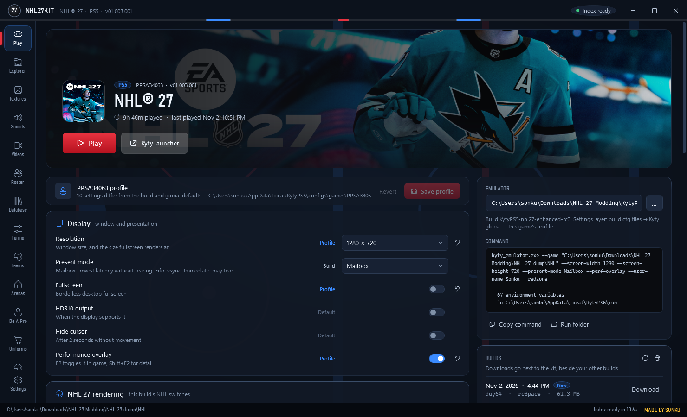

### Roster
Every player in the game with their in-game portrait: name, position, number, bio, ratings and X-Factors. **NHL sync**
pulls current rosters from the NHL (trades, signings, call-ups), and **Lines** sets each team's lines.

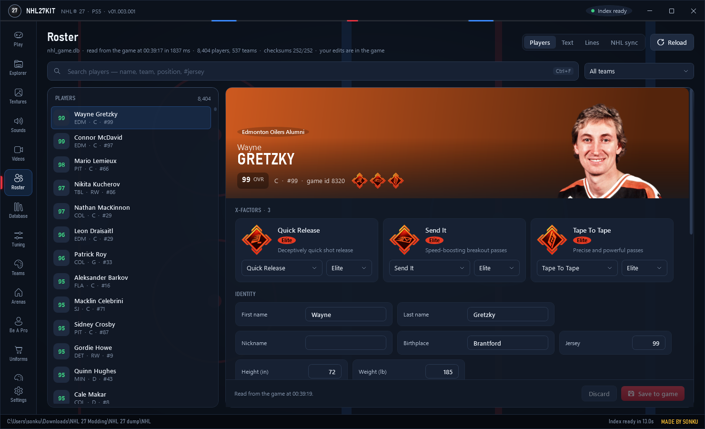

### Teams
Team names, abbreviations, colours and home arenas, plus every logo the team has (crest, ice, boards). Replace a logo
with your own picture, or build a centre-ice logo from any rink on TheFaceoff.net.

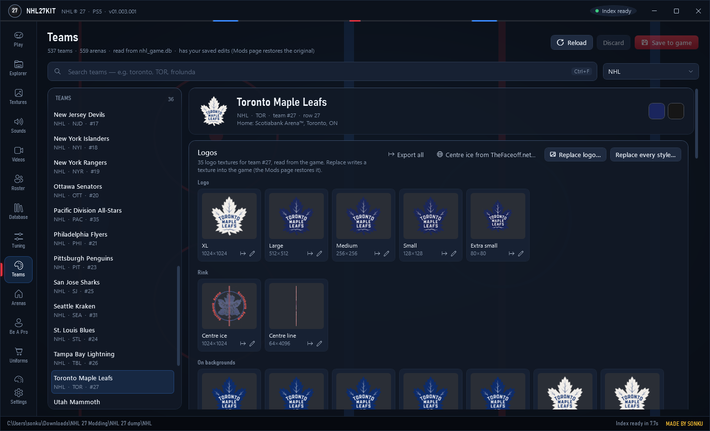

### Uniforms
Each team's jerseys on a player in 3D. Replace any jersey, pant, sock or logo texture, recolour helmets and gloves,
and add, move or rename the jerseys in a team's menu. A converter brings in jerseys made for older NHL games.

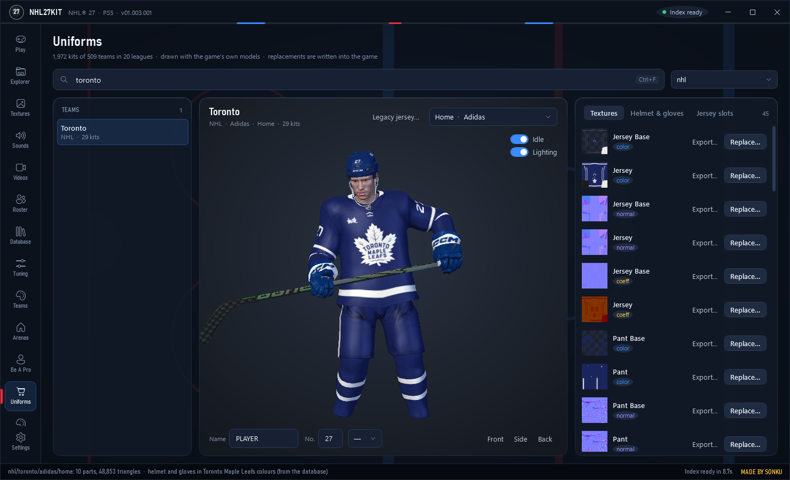

### Jersey Studio
Design your own jersey from the game's create-a-team templates: pick a pattern, colour every zone and the collar, add
stripes, and drag crests, numbers and names into place. Then write it over a team's jersey or add it to their menu.

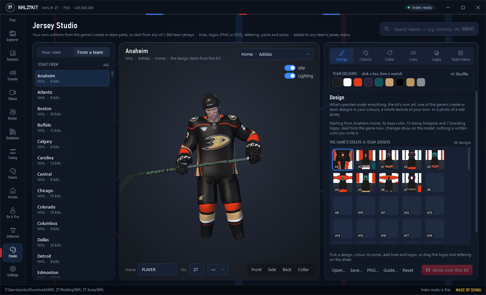

### Unused jerseys
The game ships with hundreds of jerseys that no team's menu shows, such as old alternates, All-Star sets and AHL and
ECHL thirds. Browse them all, see each one on the player, and add it to any team's menu in one click.

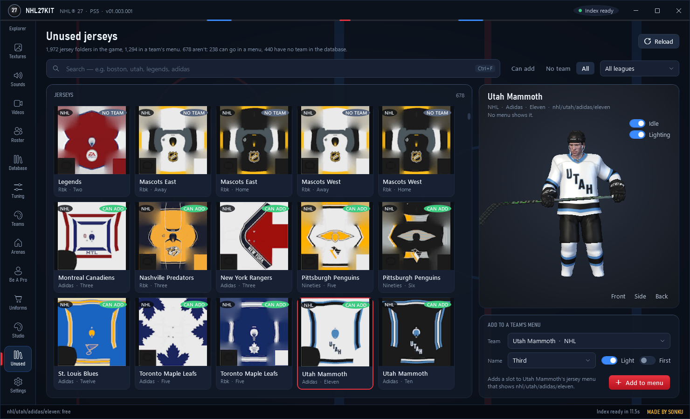

### Arenas
Every arena in 3D as the game builds it, with the ice, boards, glass, ads and jumbotron. Fly around, or jump to the
broadcast, end, bowl and overhead views.

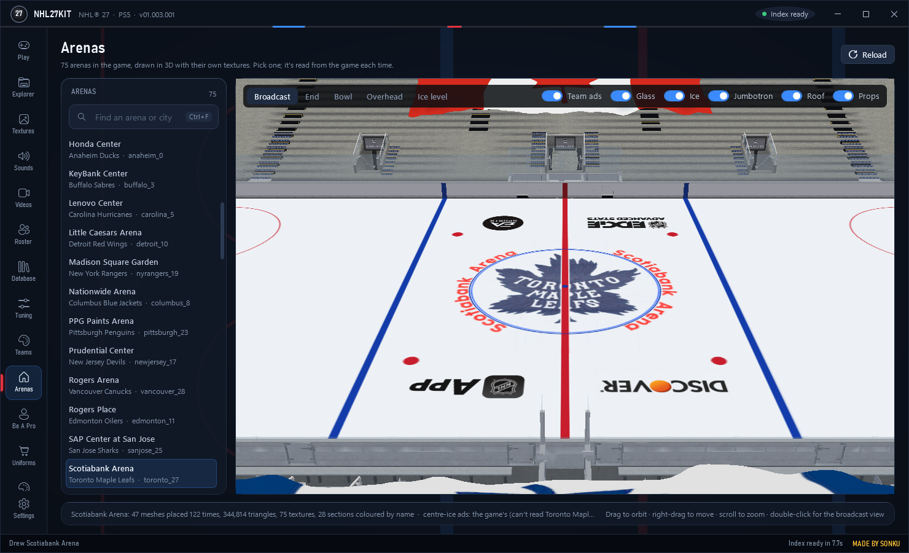

### Scorebug
The on-screen score clock with a live preview: its colours, sizes and positions. (Saving is switched off for now: a
changed score clock crashed the game when a match loaded.)

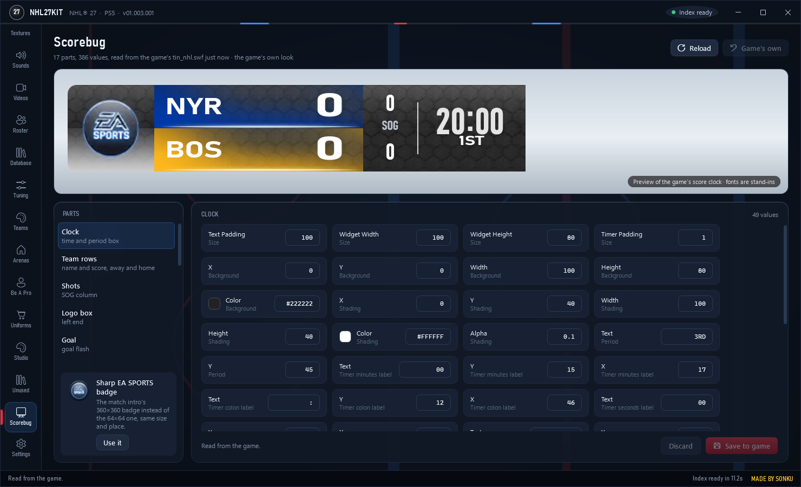

### Be A Pro
Open your Be A Pro saves and edit your player's ratings and X-Factors. The kit keeps a backup of every save it changes.

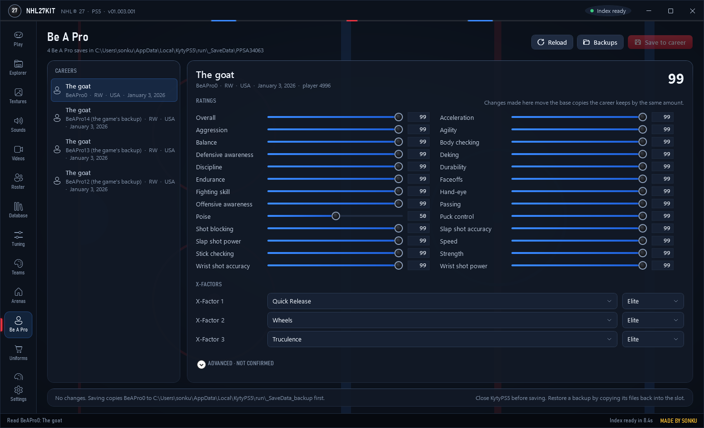

### Tuning
The gameplay values built into the game (AI, skating, shooting, checking, goalies and more), searchable and grouped,
with their defaults and ranges. Export them all as a spreadsheet.

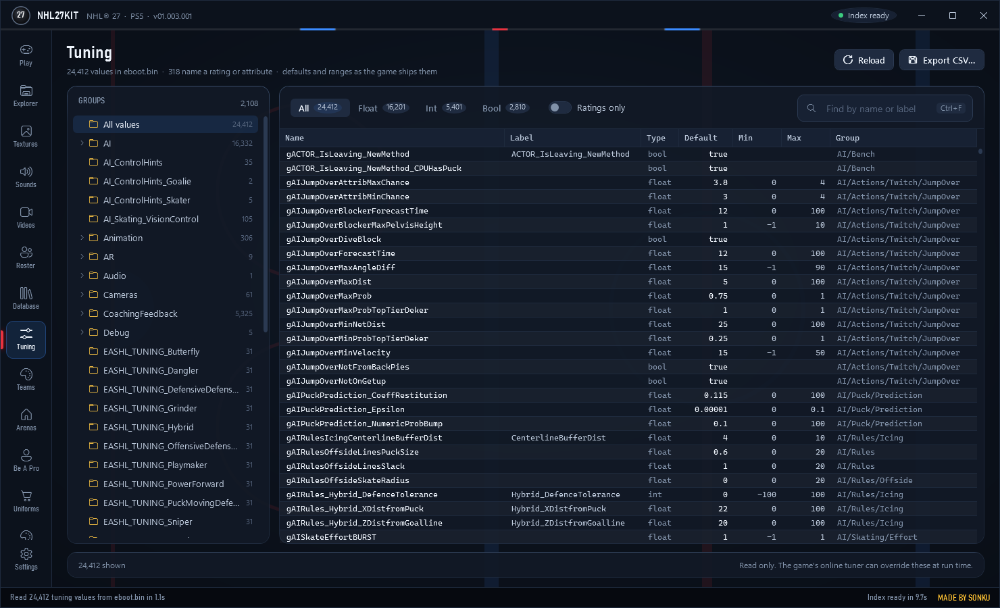

### Database
Every table of the game's databases (teams, players, schedules, jerseys, equipment…) as a spreadsheet you can search
and edit.

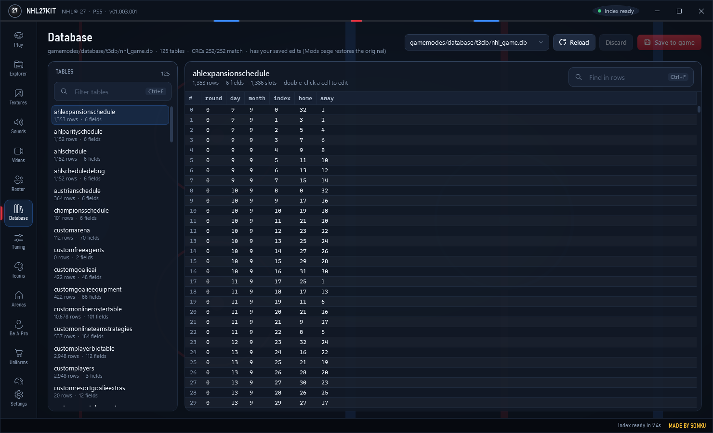

### Textures
Every texture in the game as a thumbnail gallery. Open one full size, look at each colour channel, export it as PNG
or DDS, or replace it with your own image.

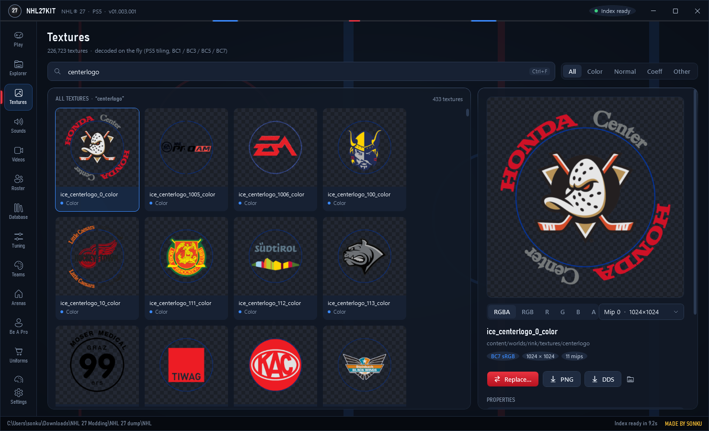

### Sounds
Every sound in the game (commentary, music, goal horns, crowds, effects) with a player. Export any of them as WAV, or
replace them with your own audio.

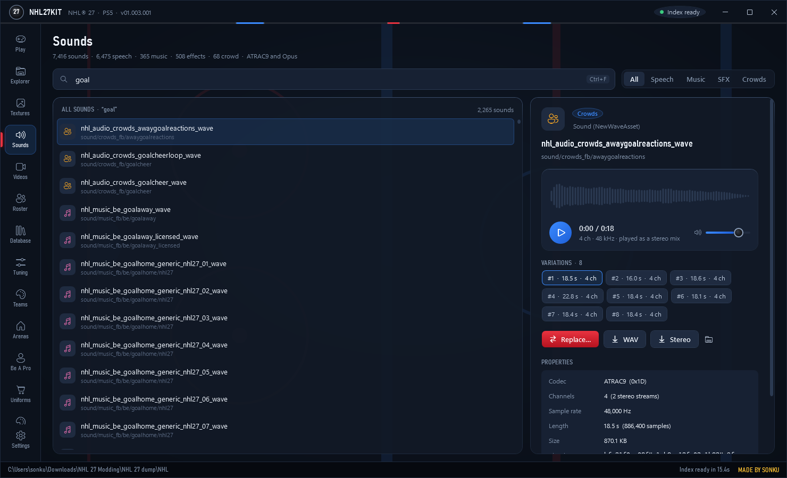

### Videos
Every video in the game (menus, arena intros, transitions, training). Play them, save them as WebM or MP4, or replace
one with your own clip.

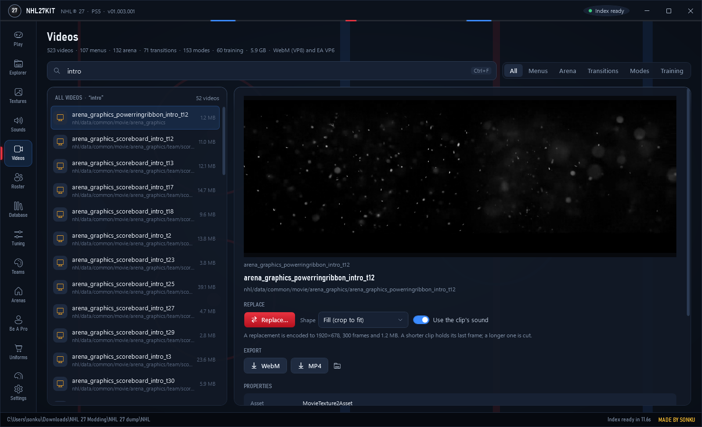

### Mods
Everything you've changed, in one list. Restore any change (or all of them), apply them again, and share your mods as
a `.nhl27mod` pack that others load with **Import pack**.

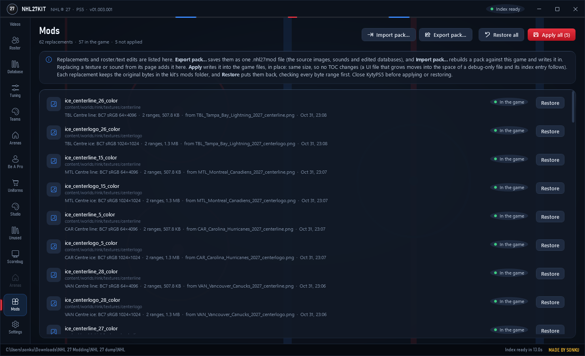

### Explorer
For advanced modders: every file inside the game's archives, with search, type filters, a hex view, and export.

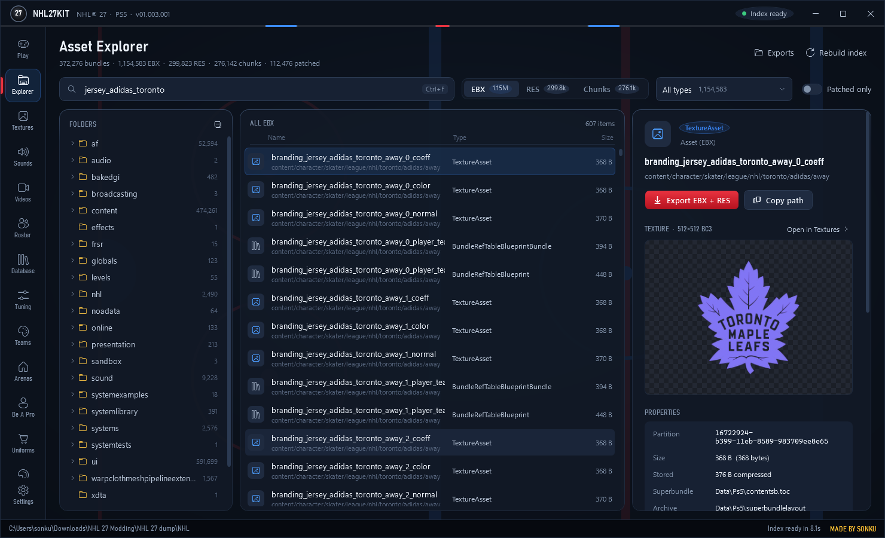

### Settings
Where the kit finds your game, and where it keeps its own files.

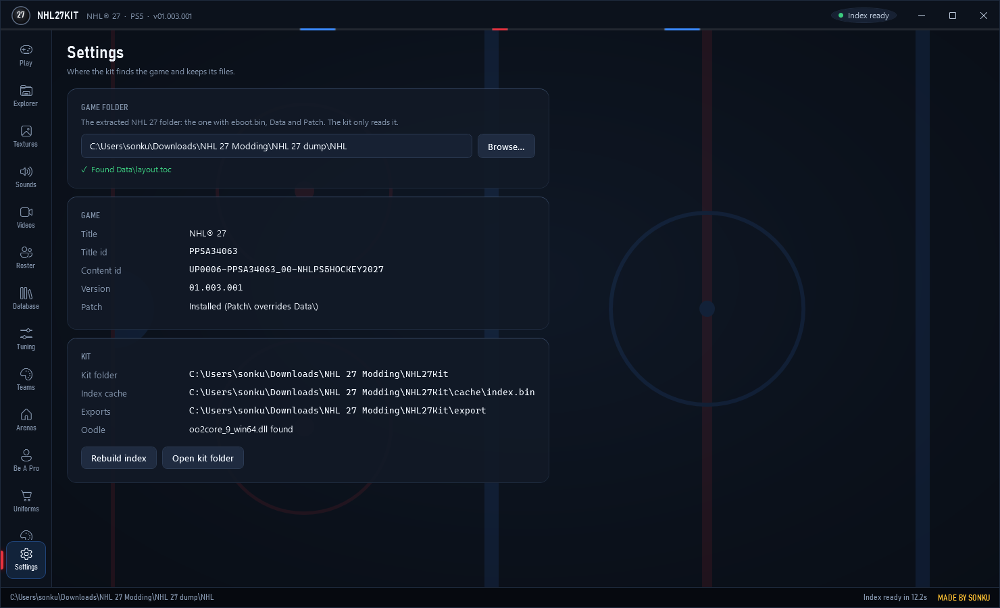

---

*Made by Sonku. A fan project, not affiliated with EA Sports or the NHL. Centre-ice graphics from TheFaceoff.net are
for personal use only; all credit to them.*

---

# Technical notes

The rest of this page is for developers: how the kit reads and writes the game. NHL27Kit is separate from NHL24Kit;
its reader started as a port of `NHL24Kit.Game`.

## Layout

- `Core/`: reader for the game's Frostbite data: `layout.toc`, superbundle TOCs, bundle records, CAS archives, EBX
  headers, Oodle blocks. No FMT dependency.
- `App/`: `NHL27Kit.exe`, the kit's window:
  - **Play** starts NHL 27 on KytyPS5 and edits the game's Kyty profile.
  - **Explorer** browses every EBX, RES and chunk, with search, type filters, details, a hex preview and export.
    A texture also shows its picture, and a sound has a player.
  - **Textures** shows every TextureAsset as a thumbnail gallery, and decodes the one you pick full size, by
    channel and mip, for export as PNG or DDS.
  - **Sounds** lists every sound (speech, music, effects, crowds) with a waveform player, its variations and WAV export.
  - **Settings** holds the game folder and shows the kit's paths.
- `Cli/`: `nhl27kit.exe`, a command-line explorer built on Core.
- `ThirdParty/`: `oo2core_9_win64.dll` (Oodle) and `opus.dll`, copied from the local FMT install. Not part of the source.
- `cache/`: the asset index (built on first use). `export/`: default export folder.

## Build

```
dotnet build NHL27Kit.slnx -c Release
```

## Play (KytyPS5)

The Play page starts `kyty_emulator.exe` itself, with the command line the Kyty launcher would build. It reads the
same settings layers as the launcher:

1. the build's `cfgGlobal.json` and `cfg<TITLE>.json`, next to the emulator
2. Kyty's global settings, `%LOCALAPPDATA%\KytyPS5\configs\kyty.json`
3. the game's profile, `%LOCALAPPDATA%\KytyPS5\configs\games\PPSA34063.json`

The page shows which layer every value comes from. Edits are saved only to the profile, and only when they differ
from the layers below; keys the kit doesn't know are kept. The first save keeps a `.bak` of the original profile.
The emulator runs in Kyty's run folder (`%LOCALAPPDATA%\KytyPS5\run`, where saves and the pipeline cache live).
Its output is logged to `logs\kyty-last-run.log`, and playtime is added to Kyty's `playtime.json`.

The emulator defaults to the launcher's choice if that file exists, else the newest `KytyPS5-*` build next to the kit.

## Textures

The decoding comes from NHL27TextureViewer (`..\NHL27TextureViewer`), ported to C# in `Core/Textures.cs`. It uses
the kit's index to find each texture's header and chunk instead of scanning the CAS files:

- The texture's RES is its header (184 bytes): pixel format at +12, size at +22/+24, mip count and first mip at
  +30/+31, chunk id at +40, mip sizes at +56, chunk size at +116.
- Formats: `0x36/37` BC1, `0x3C/3D` BC3, `0x3F` BC5, `0x42/43` BC7 (the odd code is sRGB).
- A chunk stores its mips smallest first, so mip 0 is at the end. Each mip is tiled AMD `SW_4K_S`: 16x16-block
  tiles for 16-byte blocks, 32x16 for BC1. Sizes that aren't a whole number of tiles are padded to whole tiles.
- A streamed texture's bundle lists only part of its chunk. The full chunk, with every mip, is in a TOC chunk table
  under the same id, and the kit reads that copy.
- BC5 previews rebuild blue as a normal map's Z. The BC7 tables are generated from the viewer's (DirectXTex) tables.

From the CLI, `nhl27kit texture <name> [--mip N]` or `nhl27kit texture --filter TEXT --limit N` writes PNG and DDS
files.

## Videos

The Videos page lists the game's 523 movies (`MovieTexture2Asset`): WebM (VP8, some with Vorbis sound) and EA's older
VP6. It plays them (WebView2; VP6 through ffmpeg), exports the original file or an MP4, and replaces WebM ones: the
clip is encoded with ffmpeg to the movie's size, frame rate, frame count and bytes, and the asset's frame table is
rewritten. See PLAN.md §17. CLI: `nhl27kit movies [FILTER] [--check] [--out DIR]`, `nhl27kit movie-replace NAME --video FILE`.

## Sounds

Sounds are `NewWaveAsset` EBX assets whose audio is in chunks (the format comes from NHL24Kit's `AudioCodec`):

- A chunk is an EA SPS stream: an `H` header (codec, channels, rate, samples), `D` blocks, an `E` end. The chunk ids
  are found by scanning the EBX for GUIDs the index knows as chunks. Each chunk is one variation of the sound.
- NHL 27 uses **ATRAC9** (codec 13) for music, crowds and effects, and **multistream Opus** (codec 15) for speech.
- ATRAC9: the first block starts `00` then a 4-byte config (`FE ...`) per stereo stream, and every block holds
  groups of `01` plus one superframe per stream. More than 2 channels are several stereo streams (the 8-channel goal
  songs have two silent channels). The decoder is VGAudio's, copied into `Core/Atrac9` (MIT) with a fix: its
  `Inflate` read the packed tables with one `DeflateStream.Read`, which returns short on current .NET.
- Opus: each block is one 20 ms packet, decoded with `opus.dll`.
- The player writes a stereo mix of the sound as a WAV in the temp folder and plays it with WPF's `MediaPlayer`. The
  mix averages the stereo streams that have audio. WAV export can write every channel or the mix.
- Some sounds have no audio of their own (for example `nhl_music_be_goalhome_stlouis_wave`; the `_licensed` sibling
  has it, so the sound probably plays through that or a sample bank).

From the CLI, `nhl27kit sound <name> [--wav] [--stereo]` lists a sound's chunks, or writes them as WAV files.

## Replacing textures and sounds (Mods)

**Replace…** on the Textures and Sounds pages adds a replacement to the Mods page; **Apply** there writes it into the
game files. Everything is in place and the same size, so no TOC or header changes:

- **Copies:** a chunk is stored once per TOC chunk table and once per bundle that lists it. The bundle copies are
  usually the first part of the same bytes (the smallest mips). Every copy is rewritten (`ChunkCopies`, `ChunkPatcher`).
- **SHA1s:** each bundle record holds a SHA1 of the whole stored chunk (checked against the game's own files), which
  is rewritten. NHL 24's notes say a stale one is rejected.
- **Shared data:** when another asset's TOC entry points at the same bytes (identical data stored once), the kit
  refuses, because that asset would change too. It checks this with a count of every TOC entry's start
  (`LocationIndex`, about 4 s on first use).
- **Only changed bytes:** only the spans that differ are written, plus the SHA1s.
- **Backups and checks:** each mod keeps the original and new bytes of every range in `mods\<id>\`. Apply and
  Restore check every range first (it must hold the original or the replacement, by SHA1), then write and read back.
  Nothing is written while `kyty_emulator.exe` runs.

**Textures** are encoded by the kit: BC1/BC3 (colour axis fit), BC4/BC5, and BC7 mode 6 only. They are resized to
the texture's size, get every mip (sRGB averaged in linear light), and are tiled. Mips smaller than a tile share
one 4096-byte **mip tail** tile: the n-th tail mip sits at 256-byte slot 8, 6, 5, 4, 3, 2, 1 (`MipTail`, found by
matching a real tail's blocks to downsampled mips). Re-encoding a real texture gives 42 dB (BC1/BC3), 61 dB (BC5) and
47 dB (BC7) against the original. Plain 2D textures only; arrays and cubes are refused.

**Sounds:** one *variation* is one SPS stream. A speech chunk can hold dozens of takes back to back (one line had
60), so a replacement rewrites just its stream. It is Opus (codec 15) at the highest bitrate that fits the original's
bytes, and its `E` block is padded so the stream keeps its exact length and the next one doesn't move.

**Not tested in game yet:**
- ATRAC9 sounds (music, crowds, effects) are replaced with Opus, because there is no ATRAC9 encoder. The game reads
  the codec from each stream, but whether the engine plays Opus in those places is untested.
- A different length than the original may matter to the sound's asset.
- For a sound with more than 2 channels, the replacement goes into the first stereo pair and the rest is silent.

From the CLI: `replace-texture NAME [--pattern checker] --target DIR` and `replace-sound NAME --wav FILE
[--variation N] --target DIR` run the whole cycle (plan, apply, read back, restore) on copies of the touched
archives in DIR. `copies NAME` lists a texture's stored copies and checks the SHA1s.

## Roster and Text (databases)

The Roster page reads `gamemodes/database/t3db/nhl_game.db` from the game every time: on open, on Reload, after a
save and on every player you select. Nothing is cached. The page shows each player's in-game portrait
(`ui/textures/common/playerportraits/p<artid>`), bio, jersey number and every skater or goalie rating. Text mode does the
same for the language databases (`loc/*.db`). "Save to game" writes through the mod list, with one entry per database
holding all its edits, so Restore undoes them all.

- The databases are legacy files: `globals/chunkfilecollector` names an index chunk of FNV-1 64 path hashes
  (`Core/Legacy.cs`).
- They are t3db files: tables of bit-packed records, Huffman-compressed strings and CRC-32 checks (`Core/T3Db.cs`).
- Edits happen in place. A compressed string can't grow past the bytes its original used.

## Tuning (eboot)

The Tuning page lists the 24,412 gameplay tuning values compiled into `eboot.bin`: each one's type, default, minimum,
maximum, group path and label. Some examples are how much the deke rating counts, the speed of a butterfly push and
the EASHL player-type ratings. It reads the eboot from the game every time the page opens (about a second) and caches
nothing. Pick a group in the tree, filter by type or "Ratings only", search by name or label, and Export CSV saves what's
shown. It's read only: changing a value means patching the eboot, which the kit doesn't do yet, and the game's online
tuner can override these defaults at run time. How the values are found is in `docs/eboot/README.md`.

## Be A Pro (saves)

The Be A Pro page edits a career in KytyPS5's save folder (`run\_SaveData\PPSA34063`): the pro's 26 ratings (sliders or
typed values) and three X-Factors with their tiers, named from the game's language database. Saves are read fresh
every time the page opens. Save to career refuses while KytyPS5 is running. It copies the slot to
`run\_SaveData_backup\SLOT-date-time` first, then rebuilds the save and reads it back before writing. A rating change
moves the base copies the career keeps by the same amount. An Advanced section shows the values not matched to the
game's screens yet (the six energy activities and the career's numbered settings). Goalie careers can't be edited yet,
and the game's own backup slot (`BeAPro12`) is left as it is. To undo a save, copy a backup's files back into the slot.
The format is in `docs/beapro/README.md`.

## Arenas (3D)

The Arenas page lists the game's 75 arena levels (`content/worlds/stadiums/<venue>_<id>`). NHL venues are named from
the team's arena in the database. Pick one and it is read from the game and drawn in 3D: the venue's structure meshes
with their own textures, the props the level places, and the ice. The ice shows the kit's own rink markings and the
level's centre-ice logo (`ice_centerlogo_<id>`). Placements come from the level's blueprints and prefabs
(`Core/ArenaScene.cs`). Anything other than the rink that would land over the ice is left out as misread. Views:
Broadcast, End, Bowl, Overhead and Ice level, with switches for Glass, Ice, Jumbotron, Roof and Props. The jumbotron is
the venue's scoreboard prefab (`content/worlds/scoreboard/<venue>/`). The game plays video on its screens, so the kit
shows the arena's centre logo there. Drag to orbit, right-drag to
move, and scroll to zoom. Nothing is written. Arenas whose stands are built from many placed pieces (Seattle) are only
partly drawn so far.

The four ads around centre ice are drawn in the game's own slots (`ice_centeradone..four`, mapped with UV2). With
**Team ads** on, an NHL team's ads are cut from its newest rink on TheFaceoff.net, e.g. "Toronto Maple Leafs 2027". The
layout is downloaded once into `export/faceoff/downloads`. With it off, or when the site has no rink, the game's own ads
are drawn. Every NHL arena in the game uses the same four: Discover, NHL App, NHL EDGE and EA Sports. Preview arg:
`--agameads`.

In game the four ads are set at run time and shared by every arena, so per-team ads would come from the centre logo's
texture instead (`Core/LogoAds.cs`, PLAN §22). `logo-ads [ID] [--layout FILE.rgba --layout-size W,H]` is a dry run:
it lays out the NHL ice and logo in memory and draws centre ice before and after (the decals use UV3). `--size 2048
--like content/worlds/rink/textures/common/ice_clean_coeff` makes the logo 2048², so it stays sharper than stock.
`--write` puts both in the game as two mod entries (mesh `logo-ads` and the logo's texture). It works in game for
Toronto.

`logo-ads-all` lays out every arena's logo so none show cropped. `--teams DIR` maps NHL teams to logo ids and downloads
their TheFaceoff.net layouts. `--layouts DIR --nhl DIR/teams.tsv [--ids A,B] [--write]` writes:
- each NHL team's logo as its own entry: its own ads at 2048 when DIR has its layout as `N.rgba` + `N.size`, else the
  game's four;
- every other logo with the game's four, in one entry `logo-ads:logos`;
- the other ice meshes' logo mapping, in `logo-ads:other-ice`.

It takes about 80 minutes (PLAN §22).

Textures can be made bigger: `texture-grow NAME --like REF [--layout FILE.rgba --layout-size W,H] [--write]` gives
NAME the size of REF (a game texture with that size and block size). With `--layout`, the image is a centre logo cut
from a TheFaceoff.net rink. The new data is added at the end of its CAS file and the TOC, bundle record and header are
pointed at it. It's one texture mod entry, and Restore cuts the CAS file back (PLAN §23).

## Uniforms (3D)

Pick a team and a kit (1,972 kits of 509 teams, from `content/character/skater/league/<league>/<team>/<brand>/<kit>/`).
The kit is drawn in 3D on the game's own jersey, pants and socks meshes. Drag to turn it and scroll to zoom. Every
texture of the kit has Replace…, which writes into the game and redraws.

`Core/MeshSet.cs` reads NHL 27's MeshSet:
- LOD records and sections (0x170 bytes each);
- a vertex declaration where every element is its own stream;
- geometry either inline at the end of the RES or in a chunk named by the LOD.

The helmet and gloves are tinted in the team's database colours. The helmet carries its decals (sponsor on the sides,
league shield, the player's number front and back), and the pants carry their stamped logos.

The player wears a default head (`head_male_60169`, one of the game's generic faces, with brown eyes) and holds a stick,
and plays the game's menu idle (`af/assets/nhl/clips/fe_home_selectidle`). Two switches sit in the view's corner:
**Idle** (off: the bind pose the garments are modelled in) and **Lighting** (off: the textures drawn flat). The lights
are a warm key, a cool fill and a rim from behind, and they turn with the camera.

WPF's 3D shades per vertex and can't use normal maps, so the lit view bakes each garment's normal map into its texture.
Creases, seams, stitching and embroidery darken by how far their normal leans from the surface, with a slight highlight
on the edges facing up and left. Stamped garments use their base normal map: the full one has the kit's own logos
embossed, which would show through a replaced logo. The head has its normal map too; the helmet and gloves don't yet.

`Core/PlayerAnim.cs` holds the animation code:
- `Skeleton` reads `content/rigging/skeleton/skeleton_player` (434 bones, parents, local/model/inverse bind matrices).
- `AntClip` decodes an ANT clip's DCT-compressed RES (8-frame blocks, an LSB-first bit stream).
- `PlayerIdle` maps the clip's channels to bones and gives the skinning matrices.
- `PoseSkin` blends each vertex over its 4 or 8 influences.

Garment meshes keep blend indices (usages 2/3, 4 × u16) and weights (usages 4/5, 4 × u8). The indices point straight
into the skeleton, except that the helmet's carry the high bit (its own bones) and follow `Head`. The idle has no
finger channels (the game layers the hands from separate hand rigs), so the fingers are curled to a fixed grip
around the stick: each joint turns about its local Z, the way the bind pose's slight curl goes.

## Jersey Studio

**Studio** in the sidebar designs a uniform, shown live on the 3D model. **Your own** (the default) builds it from the
game's create-a-team parts in your three colours, with no team's art or logos: pick a design, a lettering font (fill and
outline colours), pants and socks. **From a team** starts from any stamped kit instead. Either way you get:
- art: the kit's own, a whole image, or one of the game's 89 create-a-team designs in the team's colours, plus flat fills
  of the collar, yoke and other fabric regions;
- lines round the body (from the hem) and sleeves (from the cuff), each with a colour and an optional edge;
- logos and lettering: move, size, turn, hide or show every logo and number spot, replace a logo's image, or add new
  logos (PNG or DDS);
- **Write over this kit**, or **Write & add to team**: the design goes into a free kit folder and becomes a new slot in
  the picked team's jersey menu. Each part is a mod entry that Restore undoes.

**Template…** saves a guide to the jersey texture (DDS or PNG) that shows each part in its own colour, the logo and
lettering spots, and a line every 10 cm. Paint your design over it in any image editor, then load it with **Use an image**.

**From a photo…** turns a photo of a real jersey into this kit's color map. On the photo:
- drag a line up the body from the hem to the height of the armpit, beside the crest;
- drag a line along a sleeve from the cuff to the top of the shoulder;
- drag a box round the crest (switch on **Round crest** to cut a circle);
- click the collar, and the shoulders if they're a colour of their own.

The colours along each line are split into bands and measured against the game's model (hem to armpit, shoulder to
cuff), so the stripes land where the photo has them. The body and sleeves are filled flat, the stripes become lines,
and the crest is painted into the color map. The maker's, NHL and sponsor logos are switched off; the lettering stays.
You can mark from several photos, and everything can still be changed in the studio afterwards.

## Texture arrays

`TextureArrayAsset`s (type 3) are stored layer-major: layer k is the same bytes as the standalone `_k` texture. The
Textures page has a Layer picker, and Replace writes one layer, keeping the others. Replacing a branding logo on the
Uniforms page writes that layer of the kit's branding array. It also writes the standalone copy when that copy isn't
shared with other kits.

## Mod packs

Export pack… on the Mods page saves every mod into one `.nhl27mod` file: a zip of `manifest.json` plus the source
images, audio and edited databases. Import pack… rebuilds each item against the game and writes it in.

## Previews

`NHL27Kit.exe --shot file.png` renders the window to a PNG and exits. Further options set up what it shows:
`--page play|explorer|textures|sounds|settings`, `--no-index`, `--search TEXT`, `--kind ebx|res|chunk`, `--type TYPE`,
`--folder PATH`, `--select N`, `--scroll PX`, for the Textures page `--tsearch TEXT`, `--tselect N`, `--tlayer N`, for the
Sounds page `--ssearch TEXT`, `--sselect N`, `--splay`, for the Roster page `--page roster`, `--rsearch TEXT`, `--rselect N`, `--rtext`,
for the Uniforms page `--page uniforms`, `--usearch TEXT`, `--uselect N`, `--ukit N`, `--uturn DEG`, for the Arenas page `--page arenas`, `--arena LEVEL|NAME`, `--aview broadcast|end|bowl|overhead|ice`, `--alook "YAW,PITCH,DIST[,HEIGHT]"`, `--anoglass`, `--anoice`, `--anoroof`, `--anoprops`, `--anojumbo`, `--agameads`, for the Studio `--page studio`, `--jsearch TEXT`, `--jselect N`, `--jline SPEC`, `--jlogo FILE`, and for packs `--pexport FILE`, `--pimport FILE`. The `previews/` folder holds the screenshots taken while building the UI.

## CLI

The game folder defaults to `..\NHL 27 dump\NHL`. Pass `--game DIR` for another. The kit only reads the game folder.

```
nhl27kit info                                   install chunks, superbundles, bundle and chunk counts
nhl27kit index [--rebuild]                      build/load the asset index, EBX counts by type
nhl27kit list ebx --filter jersey --limit 50    list assets (ebx | res | chunk), --type TextureAsset
nhl27kit export [ebx|res|chunk] <name|guid>     write an asset's decompressed bytes (--out DIR)
nhl27kit texture <name> [--mip N] [--layer N]   decode a texture to PNG + DDS (or --filter TEXT --limit N)
nhl27kit db [NAME] [--table T] [--find TEXT]    the game's databases, tables and rows, read from the game
nhl27kit db-set NAME --table T --row R --field F --value V   edit one value in the game (through the mod list)
nhl27kit legacy [--filter TEXT] [--collector C|list] [--out DIR]   legacy files (databases, CSVs, JSON, Lua; the UI
                                                             collectors hold SWFs and layouts); --out dumps them
nhl27kit legacy NAME [--collector C] [--out FILE]           print or save one legacy file
nhl27kit legacy-set NAME --file FILE [--note TEXT]          write a whole legacy file into the game (through the mod list)
nhl27kit scorebug [--class X] [--set ID=V ...] [--sharp] [--dry F]  the score clock's style values; --set / --sharp write
                                                             them (--sharp: the 360x360 EA badge); --dry builds to a file
nhl27kit ebx-refs NAME [--scan PREFIX|*] [--skip A,B]       what an EBX imports, its bundles, and who imports it
nhl27kit tunables [--out FILE.csv]              the eboot's gameplay tuning values (default, range, group, label)
nhl27kit bap SLOTDIR [--set "Speed=90"] [--xfactor SLOT:ABILITY:TIER] [--out DIR]   a Be A Pro save's ratings and
                                                 X-Factors; edits are written to --out, never into the slot
nhl27kit arena [LEVEL] [--obj FILE] [--v]         the arena levels, or one level's placements, triangles and textures;
                                                 --obj writes it in world space (a group per mesh and material)
nhl27kit ebx-probe NAME [--match] [--arrays] [--near]   development: transforms and arrays in a level's EBX
nhl27kit mesh <name> [--obj FILE]               read a MeshSet, list LODs and parts, write an OBJ
nhl27kit idle [--t SECONDS] [--grip 0..1] [--hand left|right] [--obj FILE]   the menu idle: pose the kit, head and stick, write an OBJ
nhl27kit kits [FILTER]                          the uniform kits; for one match, its texture slots
nhl27kit mods | restore NAME                    the mod list and its state in the game; put originals back
```

## PS5 vs NHL 24 (PS4)

- Data's TOCs and `layout.toc` are unsigned, so the data starts at offset 0. Patch's TOCs are signed, with the data
  at 556.
- A TOC location group is 8 bytes, `[unk][patch][install chunk persistentIndex u32][unk][cas]`, instead of PS4's
  4 bytes `[unk][patch][catalog][cas]`. Chunk-table entries are 16 bytes, and bundle entry flag bit `0x80` starts a
  group.
- `Patch/` TOCs are deltas. Their bundles and chunks replace Data's, and the index layers them that way.
- Install chunks are `Ps5/superbundlelayout/nhl_installpackage_NN` (plus the language chunks under `_00`). The
  `Patch/` folder mirrors `Data/`.
- The `Ps5/loc/*.toc` superbundles are empty stubs (64 bytes). The real ones are split into the language install
  chunks (`superbundlelayout/nhl_installpackage_00/<lang>/loc/<lang>.toc`).
- The texture RES is 184 bytes. Two u8 fields at +32/+33 move NHL 24's layout on by 8 bytes from the chunk id.
- The type table (`Core/Data/typetables.json`) is NHL 24's. NHL 27 types that aren't in it show as guids.
